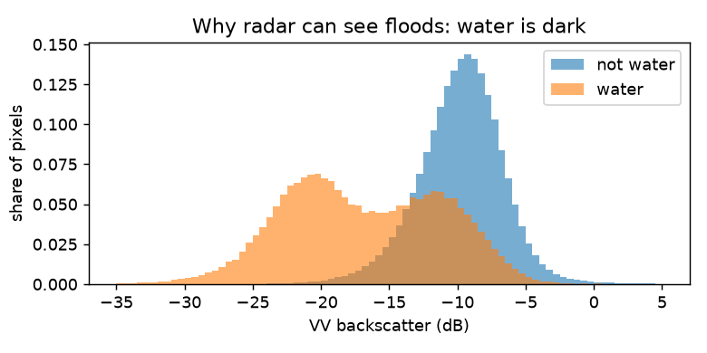
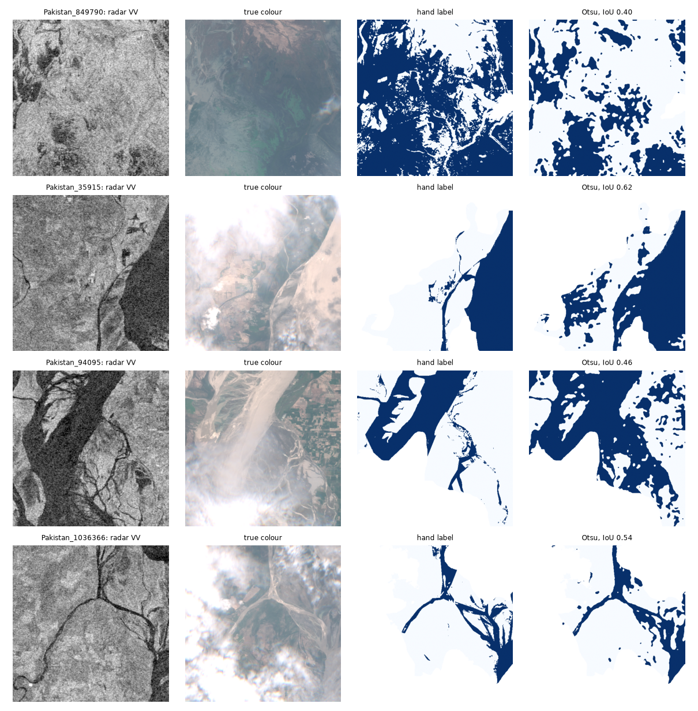
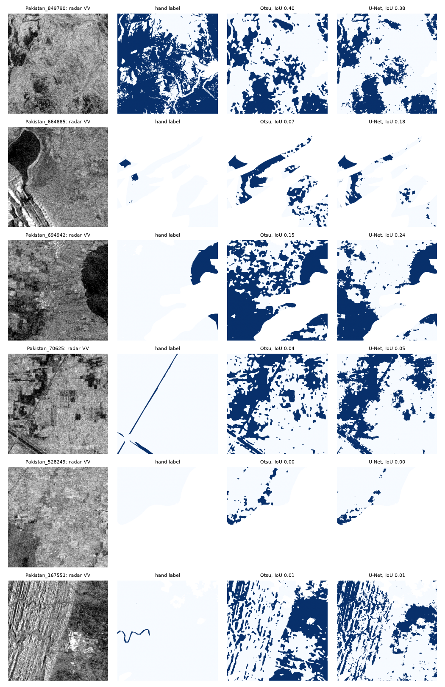
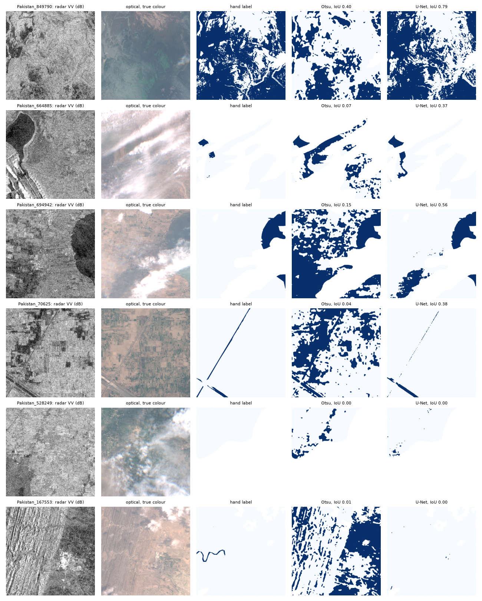
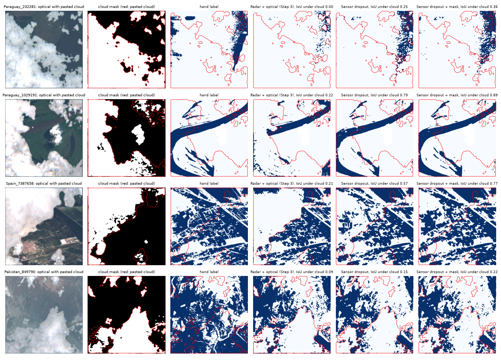
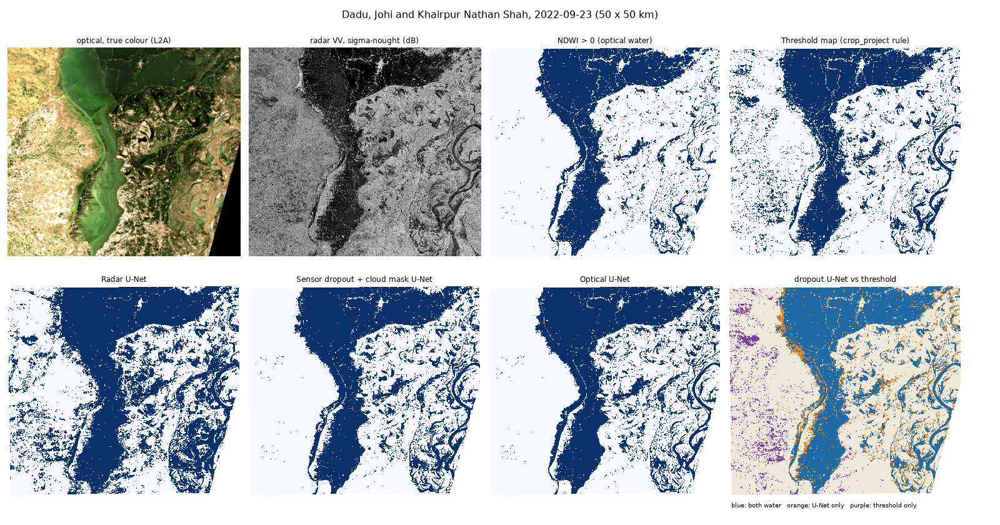

# flood_unet

Flood mapping from Sentinel-1 radar (and Sentinel-2) with a U-Net, trained and tested on the
hand-labelled part of [Sen1Floods11](https://github.com/cloudtostreet/Sen1Floods11)
(Bonafilia et al., CVPR Workshops 2020), then applied to the 2022 floods around Dadu, Pakistan.
A companion to [crop_project](https://github.com/mburhankhan101-glitch/crop_project), where the
Dadu floods were mapped with a threshold.

```powershell
python download.py     # 446 hand-labelled chips + splits, about 1.75 GB, into data/
python explore.py      # split statistics, the Otsu baseline, example chips
```

## Data
446 chips of 512 x 512 pixels at 10 m from 11 flood events (Bolivia, Ghana, India, Mekong, Nigeria,
**Pakistan**, Paraguay, Somalia, Spain, Sri Lanka, USA): Sentinel-1 VV/VH in dB, Sentinel-2 (13 bands),
and hand labels (water, not water, no data). Splits: 252 train, 89 validation, 90 test, and the
15 Bolivia chips as an event never seen in training. Pakistan has 28 chips (16 / 6 / 6).

## The baseline to beat
The dataset ships an Otsu-threshold water map for every chip. Against the hand labels (IoU of water):

| Split | IoU |
|---|---|
| Train / valid / test | 0.45 / 0.51 / 0.55 |
| Bolivia (unseen event) | 0.70 |
| **Pakistan chips** | **0.15** |

On the Pakistan chips Otsu finds 0.28 million water pixels correctly but marks 1.44 million dry
pixels as water. Otsu always splits a chip in two, even one with almost no water, and dry smooth
ground in the Indus plain is as dark to radar as water.




## Step 1: a U-Net on Sentinel-1

```powershell
python train.py        # about an hour on a laptop CPU; checkpoints every epoch, re-run to resume
python evaluate.py     # scores on test, Bolivia and the Pakistan test chips, next to Otsu
```

A four-level U-Net (1.94 million weights) on radar only (VV, VH in dB, clipped to [-35, 5] and
standardised with training statistics). Each epoch takes one random 256 x 256 crop per training chip;
cross-entropy with water weighted 9.5x (water is 9.5% of training pixels), no-data pixels ignored.
The best epoch by validation IoU is kept (epoch 26; training stopped at epoch 46 after 20 epochs
without improvement). Every chip is then mapped whole (512 x 512).

| Pooled IoU of water | Otsu | U-Net |
|---|---|---|
| Validation (89 chips) | 0.51 | **0.62** |
| Test (90 chips) | 0.55 | **0.62** |
| Bolivia, an unseen event (15 chips) | **0.72** | 0.68 |
| Pakistan test chips (6) | 0.18 | **0.22** |

- **On the familiar events the U-Net wins:** it misses 44% less water than Otsu on the test chips
  (0.35 million missed pixels against 0.63 million), for about 12% more false alarms.
- **On Bolivia, a flood it never saw, the simple threshold wins.** A model trained on ten events
  does not automatically transfer to an eleventh: the domain-shift lesson.
- **In Pakistan both fail.** The U-Net cuts Otsu's false alarms by about a third (0.24 million
  pixels against 0.35 million), but sand dunes and dry, smooth ground are as dark to radar as water.
  Optical imagery sees them as bright, which is the reason for the radar + optical step.
- Validation IoU jumped between 0.37 and 0.62 from epoch to epoch, a sign that 252 chips are few;
  augmentation is the next step.



## Step 2: augmentation, Dice loss and the decision threshold

```powershell
python train.py --name aug_ce --augment --patience 20
python train.py --name aug_cedice --augment --loss ce+dice --patience 20
python evaluate.py --name aug_ce       # and --name s1_unet, --name aug_cedice
```

An ablation, one change at a time, all with the same stopping rule (patience 20, fixed before any
test result was seen):

- **Augmentation** (`--augment`): every training crop gets a random 90-degree rotation, a random flip
  and one brightness shift of up to +/-1 dB on both bands; the label is rotated and flipped with it.
- **Dice loss** (`--loss ce+dice`): soft Dice of the water class added to the weighted cross-entropy.
- **Decision threshold**: the U-Net outputs a water probability; instead of always cutting at 0.5,
  `evaluate.py` picks the cut (0.05 to 0.95) that gives the best validation IoU and then uses it
  unchanged on test, Bolivia and Pakistan.

| Pooled IoU of water | Threshold | Best epoch | Valid | Test | Bolivia | Pakistan test |
|---|---|---|---|---|---|---|
| Otsu | - | - | 0.507 | 0.554 | **0.718** | 0.181 |
| Step 1 U-Net, cut at 0.5 | 0.5 | 26 of 46 | 0.619 | 0.618 | 0.682 | **0.215** |
| Step 1 U-Net, tuned cut | 0.6 | 26 of 46 | 0.639 | **0.652** | 0.670 | 0.198 |
| + augmentation, tuned cut | 0.6 | 22 of 42 | 0.631 | 0.643 | 0.618 | 0.189 |
| + augmentation + Dice, tuned cut | 0.5 | 44 of 60 | 0.632 | **0.652** | 0.615 | 0.193 |

(Validation IoU at a tuned cut is optimistic, because the cut was chosen on it; test is not.)

- **The cheapest change helped most.** Moving the cut from 0.5 to 0.6 lifts the Step 1 model from
  0.618 to 0.652 on test with no retraining: false alarms fall 39% (0.98 to 0.60 million pixels) for
  36% more missed water (0.35 to 0.48 million). Weighting water 9.5x in the loss pushes the model to
  say "water" too often; a higher cut undoes part of that.
- **Dice did the same thing from inside the training.** With Dice the best cut is already 0.5, and
  the test errors (0.58 million false alarms, 0.49 million missed) are almost exactly those of the
  Step 1 model at 0.6. Same result on test, reached a different way.
- **Augmentation did not help, and on Bolivia it hurt** (0.67 to 0.62). One possible reason, not
  tested: the +/-1 dB shift blurs the absolute brightness that separates water from land in radar,
  while rotations and flips add little to 252 chips of mostly flat, orientation-free scenes.
- **Bolivia still belongs to Otsu.** No version of the U-Net beats the threshold on the unseen
  event, and the gap grew with the later runs: what improves the familiar events does not carry over.
- **Caution:** one run per setting, and validation IoU swings by up to 0.1 from one epoch to the
  next. Differences of 0.01 between rows are within that noise; only the threshold effect (0.03 on
  test, the same direction on every split but Bolivia and Pakistan) and the Bolivia gap are clear.

## Step 3: radar + optical

```powershell
python train.py --name s2_unet --bands s2 --patience 20        # Sentinel-2 only, 13 bands
python train.py --name s1s2_unet --bands s1s2 --patience 20    # radar + optical, 15 bands
python evaluate.py --name s1s2_unet                            # reads the bands from the run
```

Same recipe as Step 1 (cross-entropy, no augmentation, patience 20, cut tuned on validation); only
the inputs change. Optical bands are standardised band by band with training statistics and simply
stacked with the radar as extra input channels (early fusion): the first layer grows by 1,872 weights,
0.1% of the model. Missing optical becomes 0, without changing the labels, so all models are scored on
exactly the same pixels.

| Pooled IoU of water (tuned cut) | Cut | Best epoch | Test | Pakistan test | Bolivia |
|---|---|---|---|---|---|
| Otsu | - | - | 0.554 | 0.181 | **0.718** |
| Radar only (Step 1) | 0.6 | 26 of 46 | 0.652 | 0.198 | 0.670 |
| Optical only | 0.7 | 6 of 26 | **0.830** | **0.762** | 0.671 |
| Radar + optical | 0.55 | 29 of 49 | 0.807 | 0.725 | 0.596 |
| Radar + optical, **optical removed** | 0.55 | | 0.423 | 0.072 | 0.188 |

- **Optical is the big step.** Test IoU goes from 0.65 to 0.83 and Pakistan from 0.20 to 0.76. The
  dunes and dry flat ground that fool radar are bright in near- and shortwave-infrared, while water is
  dark there.
- **Adding radar to optical did not help** on these chips (0.807 against 0.830, one run each, so the
  gap may be noise). Two reasons this test favours optical: cloudy areas were mostly left unlabelled
  by the annotators (only about 0.7% of labelled test pixels look cloudy), so the test is close to a
  clear-sky test; and the dataset README does not say which images the annotators drew the labels on,
  so optical may match the labels partly because the labels came from optical images (to check in the
  paper before claiming either way).
- **The radar + optical model leans on optical almost completely.** With the optical bands blanked it
  scores 0.42 on test, far below the radar-only model (0.65), and 0.07 in Pakistan. Under a monsoon
  cloud, which is when floods happen, it would be worse than using radar alone. The cloudiest labelled
  test chip shows the same thing: Sri-Lanka_1049830 scores 0.57 with radar only, 0.35 with radar +
  optical and 0.09 with optical only.
- **Bolivia still belongs to Otsu.** The cut chosen on validation (0.7 for optical) cost a lot on
  Bolivia: at 0.5 the optical model would have scored 0.81 there, above Otsu, but picking the cut
  after seeing Bolivia would be choosing it on the test. On a new event the model is less sure, so a
  high cut drops real water (0.15 million missed pixels against 0.05 million at 0.5).



## Step 3b: sensor dropout

```powershell
python train.py --name s1s2_drop50 --bands s1s2 --drop-optical 0.5 --patience 20
python evaluate.py --name s1s2_drop50
```

The radar + optical model of Step 3 had learned the easy route (optical) and never needed radar, so
with optical gone it fell below a radar-only model. Here half of the training crops, chosen at random,
have all optical bands blanked (set to 0, the training average, as for missing data): on those the
model can only use radar. Everything else is the Step 3 recipe. p = 0.5 and the targets were fixed
before training: optical removed on test at about 0.60 or more, and clear test within 0.02 of 0.807.

| Pooled IoU of water (tuned cut) | Test | Pakistan test | Bolivia |
|---|---|---|---|
| Radar only (Step 1) | 0.652 | 0.198 | 0.670 |
| Radar + optical (Step 3) | 0.807 | 0.725 | 0.596 |
| Radar + optical (Step 3), optical removed | 0.423 | 0.072 | 0.188 |
| **Sensor dropout** (cut 0.65) | 0.780 | 0.686 | 0.545 |
| **Sensor dropout, optical removed** | **0.611** | 0.157 | **0.669** |

- **It learned radar.** With optical removed, test goes from 0.42 to 0.61 (target met) and Bolivia
  from 0.19 to 0.67, level with the radar-only model. One model now does both jobs reasonably.
- **It cost some clear-sky accuracy:** 0.780 against 0.807 on test, a drop of 0.027, just outside the
  0.02 target. Half of the crops no longer teach the optical route. One run each, so treat the
  exact gap with care.
- **Real clouds are a different problem.** On the cloudiest labelled test chip (Sri-Lanka_1049830) the
  dropout model scores 0.06, against 0.57 for radar only. Training taught it what to do when optical
  is *missing* (zeros); a real cloud is *present and bright*, looks like dry land, and the model
  trusts it. Real use (Dadu) needs a cloud mask first: blank the optical bands where there is cloud,
  then map.
- The cut (0.65) was chosen on validation with optical present; the "optical removed" rows use the
  same cut, so they are not tuned for radar-only use.

## Step 3c: a cloud mask

```powershell
python clouds.py       # about 30 minutes; writes runs/clouds/
```

Sensor dropout taught the model what to do when optical is *missing*; a real cloud is *present*,
bright and looks like dry land. So clouds are first detected with
[s2cloudless](https://github.com/sentinel-hub/sentinel2-cloud-detector) (Sentinel Hub's per-pixel cloud
detector), the optical bands under the mask are set to 0, and the dropout model maps those pixels from
radar.

**How it is tested.** Clouds are mostly unlabelled in the hand labels, so real clouds (from 62 training
chips) are pasted onto the validation and test chips, whose labels were drawn on clear imagery and stay
true under the cloud. Radar is unchanged, as in reality. The clouds to paste are picked without
s2cloudless (bright, left unlabelled by the annotators, both sensors present), so the mask is not
tested only on clouds it is known to find. The mask's probability cut is chosen on validation by flood
IoU; smoothing (4 pixels) and dilation (2 pixels) were fixed in advance.

| Pooled IoU of water, test chips with pasted clouds | Under the cloud | Outside it | All |
|---|---|---|---|
| Radar only | **0.654** | 0.652 | 0.652 |
| Optical only | 0.051 | **0.824** | 0.495 |
| Radar + optical (Step 3) | 0.109 | 0.805 | 0.467 |
| Radar + optical (Step 3) + mask | 0.412 | 0.795 | 0.689 |
| Sensor dropout | 0.326 | 0.773 | 0.618 |
| **Sensor dropout + mask** | 0.588 | 0.779 | **0.721** |

On the real (unchanged) test chips the mask costs almost nothing: 0.780 without it, 0.784 with it
(Pakistan 0.686 to 0.668). On the cloudiest real chip, Sri-Lanka_1049830, it lifts the dropout model
from 0.06 to 0.40.

- **Under a cloud, optical models fail completely** (0.05 and 0.11): the water simply disappears.
- **Mask and dropout work together.** Either alone helps a little (0.41, 0.33 under the cloud); both
  together reach 0.59 under the cloud and the best overall score, 0.72.
- **Still below radar alone under the cloud** (0.59 against 0.65). The mask misses 7% of the pasted
  cloud pixels (mostly thin edges), and the model was trained with *whole* crops blanked, never with
  part of a crop, which is what a mask produces. Training with cloud-shaped blank patches is the next
  thing to try.
- **The best cut was the highest one tried (0.7), not a low one.** The mask also flags clear ground
  (15-27% of clear pixels next to the pasted clouds, depending on the cut; 4% of the real Pakistan
  pixels), and each wrongly masked pixel loses the optical advantage. Missing a cloud is the worse
  mistake per pixel, but false alarms of the mask are far more common. 0.7 sits at the edge of the
  grid, so a higher cut might do better still; it was not tried after the test had been seen.
- **Easier than reality:** no cloud shadows (dark, water-like in optical) were pasted, and a real flood
  day adds haze and rain.



## Step 4: Dadu 2022

```powershell
python s1_grd.py --check    # rebuilt radar against the training chips
python s2_l2a.py --check    # the L2A / L1C gap, and what it does to the model
python dadu.py              # map 23 September 2022 and compare (about 30 minutes)
```

The real test: the floods west of the Indus around Dadu, Johi and Khairpur Nathan Shah, on
23 September 2022, in crop_project's 50 x 50 km box. That day has a radar pass on crop_project's own
orbit and a clear optical image, so both maps use the same radar pass.

**Getting the same kind of input as in training was most of the work.**

| Input | What the model was trained on | What is freely available | What was done |
|---|---|---|---|
| Radar | sigma-nought from Earth Engine | Planetary Computer: raw GRD files, and a terrain-corrected gamma-nought (RTC) | sigma-nought rebuilt from the raw files: thermal noise removed, calibrated, placed with the scene's control points, then shifted into place against the RTC |
| Optical | L1C, top of atmosphere, 13 bands | L2A, haze removed, no B10 (L1C needs an account) | a straight-line conversion per band, fitted on the Pakistan training chips |

- **Rebuilt radar matches the training chips:** median difference 0.01-0.03 dB on three events
  (Bolivia, Somalia, Nigeria; the exact Pakistan pass is not on Planetary Computer). The RTC product
  is 0.9-2.1 dB brighter: using it as it is would have shifted every pixel by 0.2-0.5 standard
  deviations. The control points place pixels 40-150 m off (they assume the wrong ground height), which
  the shift onto the RTC removes; after it the smoothed images correlate at 0.98 in Bolivia and
  0.73-0.91 in Somalia and Nigeria.
- **Optical: raw L2A breaks the model.** On the 12 labelled Pakistan validation and test chips, the
  dropout model scores 0.660 with the real L1C, 0.654 without B10, **0.246 with raw L2A** (770,000 false
  alarms against 59,000) and 0.616 with converted L2A. L1C is brighter in blue by about 370 (haze);
  L2A is brighter in the infrared bands.

**Dadu, 23 September 2022** (agreement = water in both maps divided by water in either; there are no
hand labels here, so this is agreement, not accuracy):

| Map | Water, km2 | Agreement with NDWI > 0 | Agreement with the threshold map |
|---|---|---|---|
| Threshold map (crop_project rule) | 800.5 | 0.745 | 1 |
| Threshold map without its "dark in June" class | 690.2 | 0.802 | 0.862 |
| Radar U-Net | 1168.2 | 0.628 | 0.644 |
| Optical U-Net | 848.9 | 0.895 | 0.721 |
| Radar + optical U-Net | 906.8 | 0.842 | 0.715 |
| Sensor dropout + cloud mask U-Net | 869.6 | 0.854 | 0.745 |
| NDWI > 0 on the clear optical image | 683.3 (clear pixels) | 1 | 0.745 |

- **The radar U-Net does worst here** (0.63 with NDWI) and maps the most water: dark, smooth fields and
  dry ground across the box become "water". The threshold map does better with radar alone (0.80
  without its "dark in June" class) because it compares the day with June: a before / after change is
  a stronger clue than any single-date picture, and our U-Net only ever sees one date.
- **crop_project's "dark in June" class is mostly dry ground**, as crop_project suspected: NDWI calls
  20% of it water, against 95% of its "flood" class.
- **The models with optical agree best with NDWI** (0.84-0.90), but they read the same optical image as
  NDWI, so this is not independent evidence. The day was clear (94% clear pixels, cloud mask 0.2%), so
  this is a test of the radar and optical conversion, not of the cloud handling.
- The flooded area in the dropout model's map: 870 km2 in a 50 x 50 km box, about a third of it.
  The map is saved as a GeoTIFF (`runs/dadu/dadu_water_2022-09-23.tif`) that opens in QGIS or Google
  Earth, to compare with what people saw on the ground.



## Roadmap

- [x] Download the hand-labelled chips; score the Otsu baseline
- [x] U-Net on Sentinel-1 (VV, VH) vs Otsu: test, Bolivia, Pakistan
- [x] Better training: augmentation, Dice loss, a tuned decision threshold (only the threshold helped)
- [x] Radar + optical (Sentinel-2) vs radar alone (optical wins on clear pixels; the fused model ignores radar)
- [x] Train radar + optical with the optical bands randomly blanked, so it learns to fall back on radar
- [x] A cloud mask: blank cloudy optical pixels before mapping, so real clouds are treated as missing
- [ ] Sensor dropout with cloud-shaped patches instead of whole crops
- [ ] A pretrained encoder vs training from scratch
- [x] Apply the model to the 2022 Dadu floods and compare with the threshold map from crop_project
- [ ] Give the U-Net a pre-flood radar image too (before / after), now that raw radar can be rebuilt for any date
